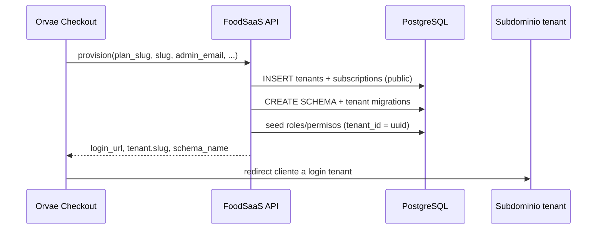
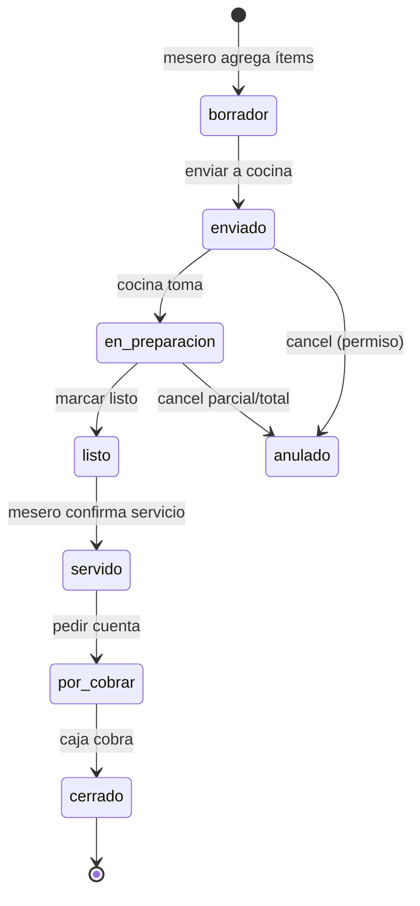

# FoodSaaS — Visión producto y arquitectura SaaS

Documento maestro para alinear desarrollo, comercialización e integración con **Orvae PE**. Describe el estado actual del repositorio `foodsaas`, el patrón de referencia **VetSaaS** y el panorama operativo de restaurante que FoodSaaS debe superar respecto a competidores como Restaurant.pe.

**Audiencia:** equipo de producto, backend, frontend e integraciones Orvae.  
**Idioma operativo de la app:** español (Perú) e inglés (i18n ya iniciado).  
**Marca producto:** primario `#660033` (implementado en `resources/css/app.css` y PWA).

---

## 1. Resumen ejecutivo

**FoodSaaS** es el vertical de restaurante del ecosistema **Orvae**: un SaaS multi-restaurante para ventas en sala, cocina, caja, inventario/recetas y (en planes superiores) logística, delivery y franquicias. La plataforma central vive en `foodsaas.orvae.pe`; cada cliente opera en `{slug}.foodsaas.orvae.pe` con **aislamiento por schema PostgreSQL** (un schema por tenant), el mismo modelo probado en VetSaaS.

**Estado actual del código (octubre 2026):** starter Laravel 12 + Inertia React con autenticación Fortify (2FA, passkeys), **RBAC Spatie con equipos (`tenant_id`)**, seeders de permisos y roles operativos, migración `users.tenant_id`, middleware `SetPermissionsTeam` (con `tenant_id()` aún stub), i18n ES/EN, PWA y shell de dashboard. **Aún no** hay resolución de tenant, tablas `tenants`/suscripciones, rutas `/plataforma/*`, API de provisioning Orvae ni módulos de negocio (pedidos, cocina, caja).

**Diferenciador frente a Restaurant.pe:** planes claros con herencia Lite→Pro, permisos granulares (`modulo.accion`), gates por plan y por módulo deshabilitado, integración nativa con checkout Orvae, KDS/cocina en tiempo real, trazabilidad pedido→inventario→foodcost, multi-sede y franquicia en Pro, y experiencia PWA para meseros/móvil.

**Próximo hito arquitectónico:** portar el stack de tenancy de VetSaaS (`ResolveTenant`, `TenantManager`, migraciones `public` + `database/migrations/tenant`, API `POST /api/internal/saas/provision`) y conectar `config/services.php` en Orvae PE (patrón ya usado para VetSaaS/TallerSaaS/SendSaaS).

---

## 2. Relación Orvae → FoodSaaS → tenants

Orvae PE es el **hub comercial y de identidad**: catálogo, checkout, suscripciones, Sales Hub y enlaces de acceso a cada producto SaaS. FoodSaaS es **autónomo en despliegue** (app + BD PostgreSQL) pero **provisionado y renovado** desde Orvae mediante endpoints internos firmados HMAC, igual que VetSaaS.

```mermaid
flowchart TB
    subgraph Orvae["Orvae PE (orvae.pe)"]
        Checkout[Checkout / Suscripciones]
        SalesHub[Sales Hub / Knowledge]
        Panel[Panel operación Orvae]
    end

    subgraph Central["FoodSaaS central — foodsaas.orvae.pe"]
        Platform["/plataforma/* — superadmin"]
        PublicSchema[(Schema public)]
        ProvisionAPI["POST /api/internal/saas/provision"]
    end

    subgraph TenantHost["Tenant — {slug}.foodsaas.orvae.pe"]
        Ops[Operación restaurante]
        TenantSchema[(Schema rest_{slug})]
    end

    Checkout -->|HMAC provision / renew| ProvisionAPI
    SalesHub -->|knowledge export| Central
    ProvisionAPI --> PublicSchema
    ProvisionAPI -->|CREATE SCHEMA + migrate tenant| TenantSchema
    Platform --> PublicSchema
    Ops --> TenantSchema
    PublicSchema -->|users.tenant_id, tenants, plans| TenantHost
```

**Flujo de alta (objetivo, alineado a VetSaaS):**

1. Cliente compra plan en Orvae (producto `foodsaas`, plan `lite|basic|regular|pro`).
2. Orvae llama `POST https://foodsaas.orvae.pe/api/internal/saas/provision` con payload firmado e idempotency key.
3. FoodSaaS crea fila en `public.tenants`, schema `rest_*`, suscripción, usuario admin del restaurante, roles por defecto y URL de login `{slug}.foodsaas.orvae.pe/login`.
4. Orvae muestra en “Mis productos” el enlace resuelto (ver `SaasTenantAccessResolver` en Orvae — hoy VetSaaS/SendSaaS/TallerSaaS; FoodSaaS previsto en tests de `SaasKnowledgeTest`).



---

## 3. Arquitectura técnica

### 3.1 Hosting y DNS

| Entorno | Host central | Host tenant | Notas |
|--------|--------------|-------------|--------|
| Producción | `foodsaas.orvae.pe` | `{slug}.foodsaas.orvae.pe` | Wildcard DNS `*.foodsaas.orvae.pe` |
| Local (Herd/Valet) | `foodsaas.test` | `{slug}.foodsaas.test` | `TENANT_ROOT_DOMAIN`, `TENANT_CENTRAL_DOMAINS` |

Variables de entorno objetivo (copiar semántica de `vetsaas/config/tenant.php`):

- `TENANT_ROOT_DOMAIN=foodsaas.orvae.pe`
- `TENANT_CENTRAL_DOMAINS=foodsaas.orvae.pe,localhost,127.0.0.1,foodsaas.test`
- `TENANT_SCHEMA_PREFIX=rest_` (validación runtime; nombre real en `tenants.schema_name`)

Orvae (`orvaepe/config/services.php`) deberá incluir bloque `foodsaas` con `provision_url`, `renew_url`, `tenant_domain`, `tenant_scheme`, `knowledge_url` — hoy referenciado en tests pero no en config productiva del monorepo Orvae.

### 3.2 PostgreSQL: schema `public` vs schema tenant

| Capa | Schema | Contenido representativo |
|------|--------|---------------------------|
| **Plataforma** | `public` | `tenants`, `plans`, `plan_features`, `subscriptions`, `subscription_payments`, `distritos`, catálogo global de `permissions`, usuarios con `tenant_id` NULL (superadmin) o UUID (staff central si aplica), `tenant_plan_overrides`, idempotency provisioning, logs de integración Orvae |
| **Restaurante** | `rest_{slug}` | Mesas, zonas, menú/categorías, pedidos y líneas, estados cocina, comandas/KDS, sesiones de caja, ventas/pagos, clientes, inventario/insumos, recetas, movimientos de stock, compras, almacenes, producción, reservas, delivery (zonas/menú online), configuración por sede, auditoría operativa |

**Regla:** toda query operativa tras `ResolveTenant` usa `search_path` `"rest_xxx", public`. Migraciones de plataforma en `database/migrations/`; migraciones tenant en `database/migrations/tenant/` aplicadas solo vía comando dedicado (`foodsaas:tenant-migrate`), patrón `TenantSchemaMigrator` en VetSaaS.

**Usuarios y RBAC:** modelo VetSaaS — usuarios en `public.users` con `tenant_id`; Spatie Permission con `teams` → columna `tenant_id` en roles/asignaciones. Permisos globales (nombres únicos); roles **por tenant** (`tenant_id` = UUID del restaurante). Superadmin: `tenant_id` NULL, rol `superadmin`, permisos `plataforma-*`.

Estado FoodSaaS: migraciones Spatie + `users.tenant_id` + `config/permission.php` (`team_foreign_key` => `tenant_id`) ya preparados; falta tabla `tenants` y wiring de `tenant_id()` en `app/Tenancy/helpers.php`.

### 3.3 Middleware stack (objetivo vs actual)

**VetSaaS** (`vetsaas/bootstrap/app.php`) — referencia a copiar/adaptar:

| Orden (prepend web) | Middleware | Función |
|---------------------|------------|---------|
| 1 | `ResolveTenant` | Subdominio → slug → `SET search_path` |
| 2 | `SetPermissionsTeam` | `setPermissionsTeamId(tenant_id())` |
| … | auth, verified, etc. | |
| alias | `tenant.required` / `tenant.none` | Separar panel central vs operación |
| alias | `tenant.match-user` | Usuario debe pertenecer al tenant del host |
| alias | `tenant.module` | `EnsureTenantModuleEnabled` |
| append | `EnsureTenantSubscriptionAccess` | Grace/suspend/cancel |
| append | `EnsureTenantHasActiveSede` | Sede activa en sesión |

**FoodSaaS actual** (`foodsaas/bootstrap/app.php`): solo `SetPermissionsTeam` prepend; **sin** `ResolveTenant`, sin aliases de tenancy, sin gates de suscripción.

Rutas: VetSaaS registra `routes/tenant.php` en dominio `{tenant_subdomain}.{root}`. FoodSaaS solo `routes/web.php` (welcome, dashboard, settings).

### 3.4 Stack aplicación

- **Backend:** Laravel, Fortify, Spatie Permission, PostgreSQL obligatorio en producción multi-tenant.
- **Frontend:** Inertia React, Tailwind, componentes UI (shadcn-style), react-i18next (`resources/js/lang/{es,en}`).
- **PWA:** manifest, iconos, `pwa-install-banner`, theme-color `#660033`.
- **Realtime (roadmap):** Laravel Reverb/Echo para KDS y “pedido listo” (VetSaaS usa broadcasting en varios módulos — reutilizar patrones de `routes/channels.php`).

---

## 4. Modelo SaaS: planes, módulos, herencia y feature flags

### 4.1 Planes comerciales (referencia Restaurant.pe mejorada)

Precios orientativos en soles (ajustables en `plans.precio_mensual`); códigos estables para Orvae y provisioning.

| Código | Nombre | Precio ref. (S/) | Público objetivo |
|--------|--------|------------------|------------------|
| `lite` | Lite | 200 | Local pequeño: ventas + caja básica |
| `basic` | Basic | 390 | Restaurante con inventario/compras y apps delivery |
| `regular` | Regular | 490 | Producción, reservas, delivery propio, foodcost |
| `pro` | Pro | 650 | Franquicias, multi-sede avanzado, abastecimiento central |

Plan `free` opcional (solo trial interno), patrón `Plan::CODIGO_FREE` en VetSaaS — no comercializar en Orvae salvo promociones.

### 4.2 Herencia de módulos (entitlements)

Cada plan **incluye todos los módulos del plan inferior**. Implementación recomendada (como VetSaaS):

1. **`plans` + `plan_features`:** límites numéricos (`max_sedes`, `max_usuarios`, `max_productos`, `max_comprobantes_mes`, …).
2. **`TenantModuleRegistry`:** lista de claves de módulo; plan define conjunto habilitado; `tenants.modulos_deshabilitados` permite overrides del superadmin (JSON array de keys).
3. **Middleware `tenant.module:{key}`** en rutas sensibles.
4. **Frontend:** ocultar navegación según snapshot Inertia `tenant.modules` (VetSaaS: `TenantModuleAccess::snapshot`).

**Mapa plan → módulos (claves propuestas):**

| Módulo (key) | Lite | Basic | Regular | Pro |
|--------------|:----:|:-----:|:-------:|:---:|
| `ventas` | ✓ | ✓ | ✓ | ✓ |
| `caja_sesiones` | ✓ | ✓ | ✓ | ✓ |
| `productos` | ✓ | ✓ | ✓ | ✓ |
| `clientes` | ✓ | ✓ | ✓ | ✓ |
| `reportes_ventas` | ✓ | ✓ | ✓ | ✓ |
| `config_general` | ✓ | ✓ | ✓ | ✓ |
| `ofertas` | | ✓ | ✓ | ✓ |
| `creditos` | | ✓ | ✓ | ✓ |
| `descuentos` | | ✓ | ✓ | ✓ |
| `integraciones_delivery` | | ✓ | ✓ | ✓ |
| `insumos` | | ✓ | ✓ | ✓ |
| `compras` | | ✓ | ✓ | ✓ |
| `almacenes` | | ✓ | ✓ | ✓ |
| `informes_compras` | | ✓ | ✓ | ✓ |
| `reservas` | | | ✓ | ✓ |
| `delivery` | | | ✓ | ✓ |
| `productos_avanzados` | | | ✓ | ✓ |
| `produccion` | | | ✓ | ✓ |
| `recetas` | | | ✓ | ✓ |
| `foodcost` | | | ✓ | ✓ |
| `informes_produccion` | | | ✓ | ✓ |
| `consumibles_modificadores` | | | | ✓ |
| `requerimientos_compra` | | | | ✓ |
| `guias_referencia` | | | | ✓ |
| `ventas_insumos` | | | | ✓ |
| `abastecimiento_central` | | | | ✓ |
| `franquicia_consolidado` | | | | ✓ |

### 4.3 Feature flags (`plan_features`)

Catálogo sugerido (extender `Plan::FEATURE_CATALOG` al portar el modelo):

| Feature | Tipo | Lite | Basic | Regular | Pro |
|---------|------|------|-------|---------|-----|
| `max_sedes` | int | 1 | 1 | 2 | 10 |
| `max_usuarios` | int | 5 | 10 | 20 | 100 |
| `max_productos` | int | 200 | 500 | 2000 | 10000 |
| `boletas_electronicas` | bool | false | true | true | true |
| `facturas_electronicas` | bool | false | false | true | true |
| `multi_almacen` | bool | false | true | true | true |
| `kds_pantallas` | int | 1 | 2 | 4 | ilimitado* |
| `delivery_menu_online` | bool | false | false | true | true |
| `franquicia_dashboard` | bool | false | false | false | true |

\*Implementar como `null` = sin tope en código o feature `max_kds_pantallas`.

### 4.4 Estados de suscripción y tenant

Alinear con VetSaaS: `trial`, `active`, `grace`, `suspended`, `cancelled`. `ResolveTenant` permite acceso en `trial`, `active`, `grace`; banner de cobro en grace. Sincronización de renovación vía `POST /api/internal/saas/renew` y jobs de recordatorio (ver `config/billing.php` en VetSaaS).

---

## 5. RBAC: catálogo de permisos por módulo

**Convención:** `{modulo}.{accion}` en minúsculas; acciones estándar: `view`, `create`, `update`, `delete`, `export`, `cancel`, `open`, `close`, acciones compuestas según dominio.

### 5.1 Ya implementado en FoodSaaS (`PermissionsSeeder::CATALOG`)

| Módulo | Acciones |
|--------|----------|
| `dashboard` | view |
| `menu` | view, create, update, delete |
| `pedidos` | view, create, update, delete, cancel |
| `mesas` | view, create, update, delete |
| `inventario` | view, create, update, delete, export |
| `caja-sesiones` | view, open, close |
| `ventas` | view, create, update, delete |
| `reportes` | view, export |
| `config-general` | view, update |
| `sedes` | view, create, update, delete, export, bulk-delete |
| `roles` | view, create, update, delete, export, bulk-delete |
| `usuarios` | view, create, update, delete, reset-password, export, bulk-delete |
| `audit-trail` | view |
| `plataforma-tenants` | view, create, update, suspend, resume, delete, export, bulk-delete, **impersonate** |
| `plataforma-planes` | view, create, update, delete |
| `plataforma-suscripciones` | view, create, update, delete, extend-trial, change-plan, cancel |
| `platform-settings` | view, update |

### 5.2 Catálogo propuesto (añadir en fases)

| Módulo | Acciones sugeridas | Plan mínimo |
|--------|-------------------|-------------|
| `cocina` | view, update, bump, recall | Lite |
| `comandas` | view, print, reprint | Lite |
| `clientes` | view, create, update, delete, export | Lite |
| `ofertas` | view, create, update, delete | Basic |
| `creditos` | view, create, update, cancel, cobrar | Basic |
| `descuentos` | view, create, update, delete | Basic |
| `insumos` | view, create, update, delete, export | Basic |
| `compras` | view, create, update, delete, approve, receive | Basic |
| `almacenes` | view, create, update, delete, transfer | Basic |
| `integraciones-delivery` | view, update, sync | Basic |
| `reservas` | view, create, update, delete, confirm | Regular |
| `delivery` | view, update, zones, menu-online | Regular |
| `recetas` | view, create, update, delete, costear | Regular |
| `produccion` | view, create, update, delete, anular | Regular |
| `foodcost` | view, export | Regular |
| `requerimientos` | view, create, update, approve | Pro |
| `franquicia` | view, export, consolidate | Pro |
| `reportes-compras` | view, export | Basic |
| `reportes-produccion` | view, export | Regular |
| `reportes-logistica` | view, export | Pro |

**Nota:** los guiones en nombres (`caja-sesiones`, `config-general`) ya están en el seeder actual; mantener consistencia al extender.

**Sincronización:** tras cambiar catálogo, ejecutar `php artisan db:seed --class=PermissionsSeeder` y actualizar `ApplicationRolesSeeder` / roles tenant. El handler de `PermissionDoesNotExist` en `bootstrap/app.php` ya guía al operador.

---

## 6. Roles operativos y matriz rol–permiso

### 6.1 Roles definidos

| Rol | Ámbito | Descripción |
|-----|--------|-------------|
| `superadmin` | Central (`tenant_id` NULL) | Plataforma SaaS; todos los permisos |
| `admin_restaurante` | Tenant | Dueño/admin; operación completa + usuarios/roles/sedes |
| `gerente` | Tenant | Turno, reportes, caja, pedidos, inventario lectura/ajuste |
| `cajero` | Tenant | Caja, ventas, ver pedidos |
| `mesero` | Tenant | Mesas, menú, crear/editar pedidos |
| `cocina` | Tenant | Ver pedidos, avanzar estados cocina |

Implementados en `ApplicationRolesSeeder` (excepto `superadmin` en `SuperadminSeeder`). Rol `cajero` en código; en comunicación producto puede mostrarse como **caja**.

### 6.2 Matriz resumida (✓ = incluido en seeder actual)

| Permiso / área | mesero | cocina | cajero | gerente | admin_restaurante | superadmin |
|----------------|:------:|:------:|:------:|:-------:|:-----------------:|:----------:|
| dashboard.view | ✓ | ✓ | ✓ | ✓ | ✓ | ✓ |
| menu.* | view | — | — | view, update | CRUD | ✓ |
| pedidos.* | view, create, update | view, update | view | + cancel | full | ✓ |
| mesas.* | view, update | — | — | view, update | CRUD | ✓ |
| inventario | — | — | — | view, update | full | ✓ |
| caja-sesiones | — | — | open, close, view | ✓ | ✓ | ✓ |
| ventas | — | — | CRUD* | create, update, view | full | ✓ |
| reportes | — | — | — | view, export | ✓ | ✓ |
| config / sedes / usuarios / roles | — | — | — | — | ✓ | ✓ |
| plataforma-* | — | — | — | — | — | ✓ |

\*Sin `delete` en cajero/gerente según seeder actual.

**Futuro:** rol `contador` (solo reportes/export SUNAT), `delivery_rider` (app reparto, módulo delivery), `chef_produccion` (producción/recetas) — mapear en fase Regular/Pro.

---

## 7. Flujo operativo detallado

### 7.1 Actores y sistemas

- **Mesero/vendedor:** PWA/tablet — mesas, carta, pedido.
- **Cocina (KDS):** pantalla — cola por estación (caliente, bar, postres).
- **Caja:** cobro, medios de pago, comprobante.
- **Gerente:** supervisión, descuentos autorizados, cierre.
- **Sistema:** descuenta inventario vía recetas; emite eventos realtime.

### 7.2 Máquina de estados del pedido

| Estado | Significado | Quién avanza |
|--------|-------------|--------------|
| `borrador` | Carrito en mesa, no enviado | mesero |
| `enviado` | Comanda a cocina | mesero |
| `en_preparacion` | Cocina trabajando | cocina |
| `listo` | Plato terminado; notificación mesero | cocina |
| `servido` | Entregado en mesa | mesero |
| `por_cobrar` | Cuenta solicitada | mesero/gerente |
| `cerrado` | Pagado y vinculado a venta | cajero |
| `anulado` | Cancelación con motivo y reglas de inventario | gerente/admin |

**Subestados por línea:** permitir parcial (pizza lista, bebida pendiente) — clave para superar UX rígida de competidores.

### 7.3 Secuencia feliz (sala)



### 7.4 Eventos de dominio (para colas, auditoría y stock)

| Evento | Efectos |
|--------|---------|
| `PedidoEnviado` | Imprime/comanda digital; snapshot precios; opcional descuento stock insumos no perecederos |
| `LineaLista` | Push a mesero; timestamp KPI cocina |
| `PedidoServido` | Métrica sala |
| `VentaRegistrada` | Cierra pedido; movimiento caja; comprobante electrónico si plan |
| `CajaSesionCerrada` | Cuadre, arqueo, reporte Z |
| `RecetaConsumida` | Al cerrar venta: baja insumos por BOM; costo foodcost |
| `CompraRecibida` | Entrada almacén; costo promedio |

### 7.5 Cierre de caja y reportes

1. Cajero inicia sesión (`caja-sesiones.open`).
2. Ventas del turno asocian `caja_sesion_id`.
3. Cierre (`caja-sesiones.close`): conteo efectivo vs sistema, notas, permisos gerente si diferencia.
4. Reportes: ventas por hora, productos top, foodcost (Regular+), compras vs consumo (Basic+).

---

## 8. Módulos funcionales ampliados vs Restaurant.pe

| Área | Restaurant.pe (referencia) | Mejora FoodSaaS |
|------|---------------------------|-----------------|
| Ventas/caja | Ventas, caja, informes | KDS + notificaciones realtime; PWA mesero; permisos finos por rol |
| Productos | Catálogo | Modificadores/consumibles (Pro); fichas técnicas y costo en Regular |
| Logística | Escritorio insumos/compras/almacén | Trazabilidad pedido→receta→stock; transferencias multi-almacén |
| Producción | Recetas, porcionado | Registro/anulación de procesos con auditoría; foodcost dashboard |
| Delivery | Integración apps | Menú online + zonas propias (Regular); API integraciones (Basic) |
| Franquicia | Plan Pro | Consolidado multi-sede, requerimientos abastecimiento, guías referencia |
| Plataforma | N/A en competidor | Orvae checkout, impersonation soporte, overrides módulo/plan |
| Compliance | Ajustes | SUNAT vía NubeFact/ similar (feature flags por plan), audit-trail |
| Idioma | ES | ES + EN nativo (ya en stack) |
| Adopción | Web | PWA instalable, marca `#660033` consistente |

---

## 9. Roadmap de implementación por fases

Alineado a lo **ya hecho** y al orden validado en VetSaaS.

### Fase 0 — Fundación ✅ (actual)

- [x] Laravel + Inertia React + Fortify (2FA, passkeys)
- [x] Spatie teams + `PermissionsSeeder` + roles operativos + superadmin
- [x] `SetPermissionsTeam`, `users.tenant_id`, páginas forbidden i18n
- [x] i18n ES/EN, PWA, identidad `#660033`
- [x] Shell dashboard / settings

### Fase 1 — Tenancy y plataforma (4–6 semanas)

- [ ] Portar: `ResolveTenant`, `TenantManager`, `SubdomainResolver`, excepciones tenant
- [ ] Migraciones `tenants`, planes, suscripciones (public)
- [ ] `config/tenant.php`, rutas `routes/tenant.php` + dominio wildcard
- [ ] Middleware: `tenant.required`, `tenant.none`, `MatchUserTenant`
- [ ] Panel `/plataforma/*` (CRUD tenants, planes, suscripciones)
- [ ] `TenantSchemaMigrator` + carpeta `database/migrations/tenant`
- [ ] Implementar `tenant_id()` real; roles seed por tenant en provisioning

### Fase 2 — Integración Orvae (2–3 semanas)

- [ ] `routes/api.php`: `SaasProvisionController` (provision, renew, lookup, status)
- [ ] HMAC middleware (`orvae.provision.hmac_secret`)
- [ ] Config Orvae `services.foodsaas`
- [ ] Knowledge export endpoint (`/custom/knowledge`) para Sales Hub

### Fase 3 — Lite operativo (6–8 semanas)

- [ ] Módulos: mesas, menú, pedidos, cocina/KDS básico, ventas, caja-sesiones, clientes
- [ ] Permisos `cocina.*`, `comandas.*`; gates plan Lite
- [ ] Eventos pedido + broadcasting “listo”
- [ ] Reportes ventas básicos

### Fase 4 — Basic logística (6 semanas)

- [ ] Insumos, compras, almacenes, ofertas, créditos, descuentos
- [ ] Integraciones delivery (webhooks)
- [ ] `TenantModuleRegistry` + UI superadmin módulos deshabilitados

### Fase 5 — Regular (6 semanas)

- [ ] Reservas, delivery propio, recetas, producción, foodcost, informes producción
- [ ] Suscripción gates avanzados, límites `plan_features`

### Fase 6 — Pro franquicia (8 semanas)

- [ ] Requerimientos, guías, ventas insumos, consolidado franquicia
- [ ] Impersonation (`TenantImpersonationController`, permiso `plataforma-tenants.impersonate`)
- [ ] Multi-sede activa (`EnsureTenantHasActiveSede`)

### Fase 7 — Endurecimiento

- [ ] Backups PostgreSQL por schema (ver `vetsaas/config/backup.php`)
- [ ] Auditoría operativa, pruebas E2E pedido→caja→stock
- [ ] Documentación operativa para soporte Orvae

---

## 10. Referencias a archivos clave (copiar/adaptar)

### 10.1 VetSaaS (`D:\Programacion\Laravel\LaraReact\vetsaas`)

| Tema | Ruta |
|------|------|
| Resolución tenant | `app/Http/Middleware/ResolveTenant.php` |
| Permisos team | `app/Http/Middleware/SetPermissionsTeam.php` |
| Match usuario–tenant | `app/Http/Middleware/MatchUserTenant.php` |
| Gate módulo | `app/Http/Middleware/EnsureTenantModuleEnabled.php` |
| Gate suscripción | `app/Http/Middleware/EnsureTenantSubscriptionAccess.php` |
| Registro módulos | `app/Support/Tenancy/TenantModuleRegistry.php`, `TenantModuleAccess.php` |
| Migraciones tenant | `app/Tenancy/TenantSchemaMigrator.php`, `database/migrations/tenant/` |
| Config tenancy | `config/tenant.php`, `config/permission.php` |
| Bootstrap middleware | `bootstrap/app.php` |
| Rutas tenant | `routes/tenant.php`, bloque `then:` en bootstrap |
| Provisioning API | `app/Http/Controllers/Api/Internal/SaasProvisionController.php`, `routes/api.php` |
| Provisioner servicio | `app/Services/Tenancy/TenantProvisioner.php` |
| Impersonation | `app/Http/Controllers/TenantImpersonationController.php` |
| Planes/features | `app/Models/Plan.php`, `PlanFeature.php`, `Subscription.php` |
| Tabla tenants | `database/migrations/2026_05_12_070060_create_tenants_table.php` |
| Roles tenant seed | `database/seeders/TenantRolesSeeder.php` |
| Orvae HMAC/knowledge | `app/Support/Sales/OrvaeSalesHubClient.php`, `config/orvae.php` |

### 10.2 Orvae PE (`D:\Programacion\Laravel\LaraReact\orvaepe`)

| Tema | Ruta |
|------|------|
| Resolución URL tenant SaaS | `app/Services/Checkout/SaasTenantAccessResolver.php` |
| Config productos SaaS | `config/services.php` (añadir bloque `foodsaas`) |
| Tests contrato FoodSaaS | `tests/Feature/SalesHub/SaasKnowledgeTest.php` |
| Colores producto UI | `resources/js/components/operacion/openwa/saasColors.ts` (`foodsaas: '#e04f5f'` — revisar alinear a `#660033` en Orvae si se desea consistencia) |

### 10.3 FoodSaaS (estado actual)

| Tema | Ruta |
|------|------|
| Permisos | `database/seeders/PermissionsSeeder.php` |
| Roles operativos | `database/seeders/ApplicationRolesSeeder.php` |
| Superadmin | `database/seeders/SuperadminSeeder.php`, `config/platform.php` |
| Tenancy stub | `app/Tenancy/helpers.php` |
| Middleware RBAC | `app/Http/Middleware/SetPermissionsTeam.php`, `bootstrap/app.php` |
| User + superadmin | `app/Models/User.php` |
| i18n / PWA | `resources/js/lib/i18n.ts`, `resources/js/app.tsx`, `resources/js/components/pwa-install-banner.tsx` |
| Marca | `resources/css/app.css` (`--brand-600`) |

---

## Apéndice A — Layout de tablas tenant (borrador)

Entidades mínimas en schema `rest_*` para soportar el flujo §7:

- `cfg_sedes`, `cfg_zonas`, `cfg_mesas`
- `cat_categorias`, `cat_productos`, `cat_modificadores` (Pro)
- `ope_pedidos`, `ope_pedido_lineas`, `ope_pedido_eventos`
- `ope_comandas` / vistas KDS por estación
- `fin_caja_sesiones`, `fin_ventas`, `fin_pagos`
- `inv_insumos`, `inv_recetas`, `inv_receta_lineas`, `inv_movimientos`
- `log_compras`, `log_compras_lineas`, `log_almacenes`
- `res_reservas` (Regular)
- `del_zonas`, `del_pedidos` (Regular)

Catálogo SUNAT/comprobantes puede vivir en public o tenant según decisión de facturación (VetSaaS mezcla configuración tenant en schema clínica).

---

## Apéndice B — Convenciones de implementación

1. **Rutas tenant:** prefijo nombre `tenant.*`; dominio `{tenant_subdomain}.foodsaas.orvae.pe`.
2. **Rutas plataforma:** prefijo `plataforma.*`, middleware `tenant.none` + permisos `plataforma-*`.
3. **Policies:** una policy por agregado; autorización compuesta: permiso Spatie **y** módulo habilitado **y** feature plan.
4. **IDs:** UUID para tenants (compat Orvae); bigserial/uuid interno en tablas tenant según volumen.
5. **No mezclar datos operativos en public** salvo usuarios, RBAC y metadatos SaaS.

---

*Documento generado para guiar la evolución de FoodSaaS. El código fuente prevalece sobre este texto donde ya exista implementación; actualizar este archivo al cerrar cada fase del roadmap.*
